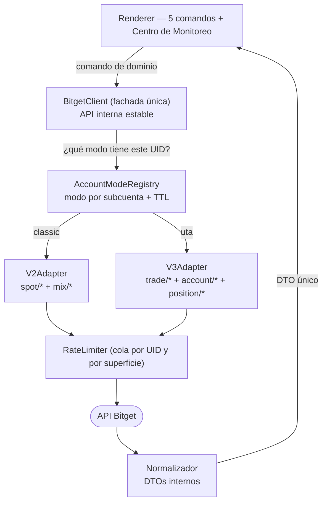
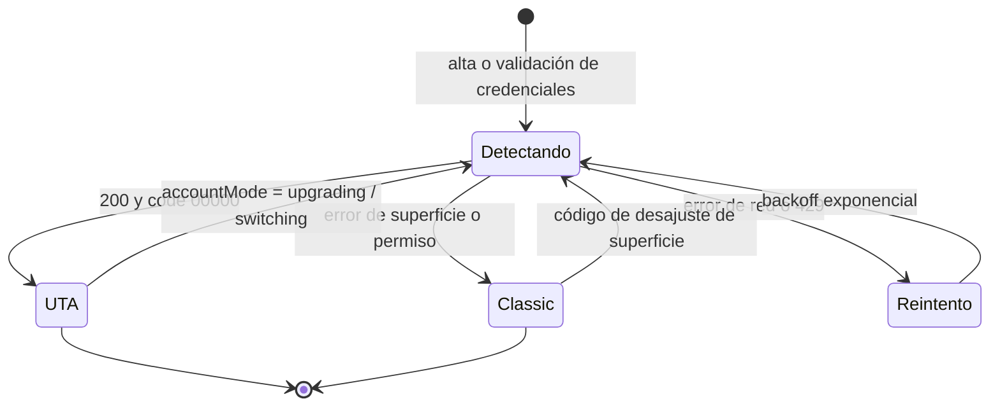
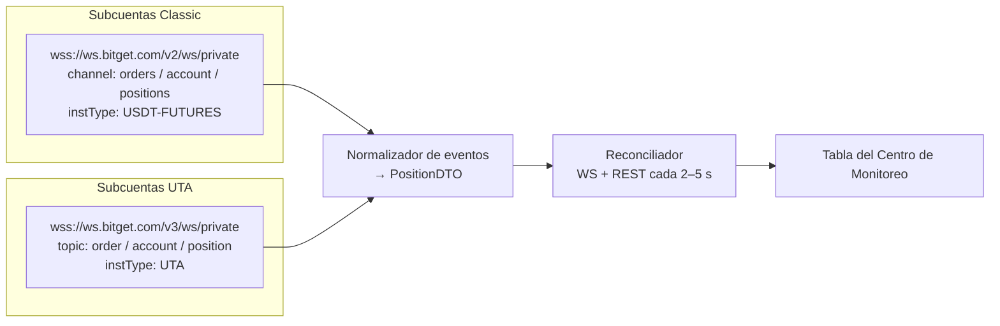

# PCB — Integración Bitget API V3 (UTA) con convivencia V2

Documento de contexto para Claude Code. Objetivo: que el Panel de Control Bitget opere
subcuentas **Classic (V2)** y **UTA (V3)** simultáneamente, sin que el operador note diferencia
y sin reescribir la lógica de negocio existente.

> Verificado contra la documentación oficial de Bitget al 7 de septiembre de 2026.
> Fuentes: `bitget.com/api-doc/classic/uta-api-upgrade-guide`, `bitget.com/api-doc/uta/*`.

---

## 1. Reglas duras

Estas restricciones no son negociables; cualquier propuesta que las rompa es incorrecta.

1. **No romper V2.** Las cuentas Classic en producción deben seguir operando exactamente igual
   durante y después de la migración. Cero cambios de comportamiento observable.
2. **Nunca duplicar una orden.** Un timeout no distingue entre "no entró" y "entró y se perdió la
   respuesta". Prohibido reintentar una orden de apertura/cierre contra la otra API sin protección
   de idempotencia.
3. **El modo de cuenta se resuelve una vez, no por llamada.** Detectar y cachear; enrutar directo.
4. **Una sola fachada.** La lógica de negocio (los 5 comandos + monitoreo) no debe saber si habla
   V2 o V3. Solo conoce `BitgetClient`.
5. **Sin permisos de retiro.** Se conserva lo pactado en contrato: solo lectura y trading.

---

## 2. Qué cambia realmente

| Aspecto | Classic (V2) | UTA (V3) |
|---|---|---|
| Base URL | `https://api.bitget.com/api/v2/` | `https://api.bitget.com/api/v3/` |
| Autenticación | `ACCESS-KEY`, `ACCESS-SIGN`, `ACCESS-TIMESTAMP`, `ACCESS-PASSPHRASE` | **idéntica, sin cambios** |
| Firma | `timestamp + METHOD + requestPath [+ "?" + query] + body`, HMAC-SHA256 → base64 | **idéntica** |
| Superficie | endpoints separados `spot/*` y `mix/*` | endpoints unificados `trade/*`, `account/*`, `position/*` |
| WS público | `wss://ws.bitget.com/v2/ws/public` | `wss://ws.bitget.com/v3/ws/public` |
| WS privado | `wss://ws.bitget.com/v2/ws/private` | `wss://ws.bitget.com/v3/ws/private` |
| Envelope | `{code, msg, requestTime, data}` | **igual**; éxito = `code === "00000"` |

**Consecuencia crítica:** una API Key emitida sobre cuenta UTA **no puede** consultar endpoints
Classic. El firmado se reutiliza tal cual — el trabajo real está en el ruteo y en la traducción de
parámetros, no en la criptografía.

---

## 3. Arquitectura de convivencia



Puntos clave del diagrama:

- `BitgetClient` es lo único que toca la capa de negocio. Su firma **no cambia** respecto de hoy.
- `AccountModeRegistry` es el único componente que decide superficie. Es el punto de fallo único
  a proteger con pruebas.
- El normalizador colapsa las dos formas de respuesta en un solo DTO interno. La tabla del
  Centro de Monitoreo consume ese DTO, no la respuesta cruda.
- El `RateLimiter` mantiene colas independientes por superficie: los límites de V3 son por endpoint
  y por UID (ej. `place-order` 10/s/UID, `close-positions` 5/s/UID, `current-position` 20/s/UID).

### Contrato del adaptador

```ts
export type AccountMode = 'classic' | 'uta';

export interface SubaccountCredentials {
  uid: string;
  apiKey: string;
  secretKey: string;
  passphrase: string;
}

/** DTO interno — idéntico para V2 y V3. El resto del sistema solo ve esto. */
export interface PositionDTO {
  uid: string;
  symbol: string;
  side: 'long' | 'short';
  size: string;
  entryPrice: string;       // V2: averageOpenPrice   | V3: avgPrice
  liquidationPrice: string; // V2: liquidationPrice   | V3: liquidationPrice
  takeProfitPrice: string | null;
  leverage: string;
  marginMode: 'crossed' | 'isolated';
  updatedAt: number;
}

export interface OrderResult {
  uid: string;
  ok: boolean;
  orderId?: string;
  clientOid: string;
  state: 'confirmed' | 'failed' | 'unknown'; // tri-estado ya existente
  errorCode?: string;
  errorMsg?: string;
}

export interface BitgetAdapter {
  readonly mode: AccountMode;
  openPosition(p: OpenParams): Promise<OrderResult>;
  closePosition(p: CloseParams): Promise<OrderResult>;
  setTakeProfit(p: TakeProfitParams): Promise<OrderResult>;
  addMargin(p: AddMarginParams): Promise<OrderResult>;
  setLeverage(p: LeverageParams): Promise<OrderResult>;
  getPositions(p: { category: string }): Promise<PositionDTO[]>;
}
```

Implementar `V2Adapter` envolviendo el código actual (sin tocarlo) y `V3Adapter` nuevo.
`BitgetClient` selecciona uno u otro por UID.

---

## 4. Detección del modo de cuenta

El endpoint de verdad es `GET /api/v3/account/settings`. Devuelve:

```json
{
  "code": "00000",
  "data": {
    "uid": "1111111111",
    "accountMode": "hybrid",
    "assetMode": "multi_assets",
    "accountLevel": "advanced",
    "holdMode": "one_way_mode",
    "symbolConfigList": [
      { "category": "USDT-FUTURES", "symbol": "BGBUSDT", "marginMode": "crossed", "leverage": "20" }
    ]
  }
}
```

`accountMode` toma los valores `unified`, `hybrid`, `upgrading` y `switching`.
`holdMode` es `one_way_mode` o `hedge_mode` — **esto decide si `posSide` es obligatorio**.



Algoritmo:

```
detectMode(creds):
  res = GET /api/v3/account/settings   (firmado con las credenciales de ESA subcuenta)
  si res.code == "00000":
      si res.data.accountMode in ("upgrading","switching"):
          marcar TRANSICION -> no operar, reintentar en 60s, avisar en UI
      guardar { mode:'uta', holdMode: res.data.holdMode, level: res.data.accountLevel }
  si error de red / 429:
      backoff exponencial, NO concluir 'classic'
  cualquier otro error de negocio:
      guardar { mode:'classic' }
  persistir en la BD local junto con las credenciales cifradas
```

**Cuándo se ejecuta:**

1. Al dar de alta la subcuenta o al revalidar credenciales.
2. Al arrancar la app, para todas las cuentas registradas, en paralelo con límite de concurrencia.
3. Re-detección forzada cuando una llamada devuelve un código de desajuste de superficie.
4. Cada 24 h como refresco de fondo.

> **Pendiente de verificar en el paquete A:** el valor exacto de `accountMode` que devuelve una
> cuenta que sigue siendo Classic, y el código de error concreto cuando una key Classic llama V3.
> Se confirma empíricamente con una subcuenta de cada tipo antes de fijar el mapeo. No inventar
> el valor: el algoritmo de arriba ya es correcto porque trata "cualquier fallo de negocio" como
> Classic.

### Fallback cruzado — cómo sí y cómo no

La idea de "intento V2 y si falla intento V3" es correcta como red de seguridad y peligrosa como
mecanismo principal. Reglas:

- **Nunca** hacer fallback ante timeout, error de red o 5xx en operaciones de escritura
  (apertura, cierre, TP, margen). Ahí el resultado es desconocido → estado `unknown`, se reconcilia
  consultando por `clientOid`, no se reintenta a ciegas.
- **Sí** hacer fallback ante un código de negocio que indique inequívocamente superficie incorrecta.
  En ese caso: invalidar el registro de modo, re-detectar, reintentar **una vez** con el mismo
  `clientOid`.
- Las lecturas (`getPositions`) sí pueden reintentar libremente: son idempotentes.

---

## 5. Traducción de parámetros

| V2 | V3 | Nota |
|---|---|---|
| `productType: "usdt-futures"` | `category: "USDT-FUTURES"` | renombrado y en mayúsculas |
| `size` | `qty` | misma semántica |
| `marginCoin` | — | eliminado; UTA lo resuelve solo |
| `marginMode` (obligatorio en orden) | `marginMode` opcional en la orden | default `crossed`; el modo real vive en la cuenta/posición |
| — | `posSide: "long" \| "short"` | **obligatorio en hedge mode**, se omite en one-way |
| — | `timeInForce` | `gtc` por defecto; `ioc`, `fok`, `post_only`, `rpi` |
| `idLessThan` | `cursor` | paginación |
| `instId` (WS) | `symbol` (WS) | |
| `channel` (WS) | `topic` (WS) | |

Valores de `category`: `SPOT`, `MARGIN`, `USDT-FUTURES`, `COIN-FUTURES`, `USDC-FUTURES`.

`clientOid`: 1–32 caracteres, letras, dígitos, `. : / _ -`. **El generador actual del PCB debe
validarse contra esa lista** — si hoy emite otro carácter, V3 rechaza la orden.

---

## 6. Mapa por función del PCB

| Función del panel | V2 (hoy) | V3 (UTA) |
|---|---|---|
| Apertura de operaciones | `POST /api/v2/mix/order/place-order` | `POST /api/v3/trade/place-order` |
| Cierre individual | `POST /api/v2/mix/order/cancel-order` / orden inversa | `POST /api/v3/trade/place-order` con `reduceOnly` |
| Cierre masivo | por cuenta, orden por orden | `POST /api/v3/trade/close-positions` (5/s/UID) |
| Take Profit por % | orden TP/SL de plan | `POST /api/v3/trade/place-order` con `takeProfit`, `tpTriggerBy`, `tpOrderType` |
| Agregar margen (USDT) | `POST /api/v2/mix/account/set-margin` | `POST /api/v3/account/set-margin` (`operation: "add"`, `amount`) |
| Ajuste de apalancamiento | `POST /api/v2/mix/account/set-leverage` | `POST /api/v3/account/set-leverage` (`longLeverage`/`shortLeverage` en hedge) |
| Posiciones (monitoreo) | `GET /api/v2/mix/position/all-position` | `GET /api/v3/position/current-position` (20/s/UID) |
| Estado de cuenta | `GET /api/v2/spot/account/info` | `GET /api/v3/account/settings` |
| Balances | `GET /api/v2/mix/account/accounts` | `GET /api/v3/account/assets` |

Campos de `current-position` que alimentan el Centro de Monitoreo:
`avgPrice` (entrada), `liquidationPrice` (liquidación), `markPrice`, `total`, `posSide`,
`leverage`, `marginMode`, `holdMode`, `updatedTime`.

`close-positions` devuelve una **lista** de resultados con `orderId`, `clientOid`, `code` y `msg`
por posición. El manejo de fallos parciales ya existente debe consumir esa lista, no un booleano.

---

## 7. WebSocket — el punto delicado del monitoreo



Diferencias de suscripción:

```jsonc
// V2 privado — tres suscripciones por producto
{"instType": "USDT-FUTURES", "channel": "positions", "instId": "default"}

// V3 privado — una sola instType cubre todo
{"instType": "UTA", "topic": "position"}
```

V3 unifica bajo `instType: "UTA"` los topics `order`, `account` y `position`. Público en V3 usa
`instType` en minúsculas y `topic` en lugar de `channel` (`publicTrade`, `kline` con `interval`
como campo aparte).

**Regla de implementación:** una conexión WS por subcuenta y superficie, gestionada por un pool con
reconexión y backoff. El normalizador emite siempre `PositionDTO`. La tabla **no debe** contener
un solo `if (mode === 'uta')`. Si aparece uno, la abstracción está mal puesta.

---

## 8. Orden de implementación

Cada punto es un PR independiente y desplegable. No avanzar al siguiente sin regresión verde.

1. **Registry + persistencia.** Campo `accountMode` y `holdMode` en la tabla local de cuentas,
   migración de esquema, valor por defecto `classic` para las existentes. Sin cambios de conducta.
2. **`V2Adapter` como envoltorio.** Extraer el cliente actual detrás de la interfaz `BitgetAdapter`
   sin modificar su lógica. La app debe seguir funcionando idéntica. **Esta es la red de seguridad
   de todo lo demás.**
3. **Firmado y transporte V3.** Cliente HTTP V3 con el mismo firmador, `paptrading: 1` para demo,
   envelope y códigos de error. Probar contra `GET /api/v3/account/settings`.
4. **Detección de modo.** Implementar `detectMode`, cachear, exponer el estado en la UI de cuentas
   (un indicador Classic/UTA por fila).
5. **`V3Adapter` — lecturas.** `getPositions` primero: es idempotente y permite validar la
   traducción de campos sin arriesgar dinero.
6. **`V3Adapter` — escrituras.** En este orden: apalancamiento → margen → TP → cierre → apertura.
   De menor a mayor consecuencia si algo sale mal.
7. **WS V3 + normalizador.** Pool dual, reconexión, reconciliación con REST.
8. **Fallback cruzado y tri-estado.** Solo después de que todo lo anterior funcione.
9. **Regresión completa + demo.** Ver checklist.

---

## 9. Checklist de pruebas

Ambientes: usar **cuenta demo** (`paptrading: 1`) para todo lo destructivo antes de tocar real.

- [ ] Una cuenta Classic ejecuta las 5 funciones exactamente como antes de la migración.
- [ ] Una cuenta UTA ejecuta las 5 funciones y el resultado aparece en el reporte por cuenta.
- [ ] Selección mixta: la misma acción sobre Classic + UTA a la vez devuelve un reporte con
      resultado correcto por cada cuenta, incluidos fallos parciales.
- [ ] El Centro de Monitoreo muestra en la misma tabla posiciones de ambos tipos, con entrada y
      liquidación correctas.
- [ ] Una posición cerrada desaparece de la tabla en ambos tipos; la fila se elimina al quedar la
      cuenta sin posiciones.
- [ ] Reposicionamiento: entrada y liquidación promediadas se reflejan igual en ambos tipos.
- [ ] Hedge mode: `posSide` se envía y las operaciones long/short no se cruzan.
- [ ] One-way mode: `posSide` se omite y `reduceOnly` funciona.
- [ ] `clientOid` generado pasa la validación de caracteres de V3.
- [ ] Timeout simulado en apertura: la orden queda `unknown`, se reconcilia por `clientOid` y
      **no** se duplica.
- [ ] Cuenta en `accountMode: upgrading`: la UI la marca en transición y bloquea operaciones.
- [ ] Rate limit: 20 cuentas en paralelo no disparan 429 en ninguna superficie.
- [ ] Reconexión WS: matar la conexión de una subcuenta UTA y verificar que la fila se recupera.

---

## 10. Notas de riesgo

- Una subcuenta que pasa a UTA **no puede volver** a Classic. Las pruebas destructivas de modo van
  en subcuentas desechables, nunca en las de producción.
- La cuenta principal está en el límite de 20 subcuentas de Bitget. Liberar un espacio o pedir
  ampliación a soporte antes de empezar el paquete de pruebas.
- Bitget no ha anunciado fecha de apagado de V2. El riesgo no es una fecha, es que un titular
  actualice su cuenta por su cuenta y desaparezca del panel sin aviso.
